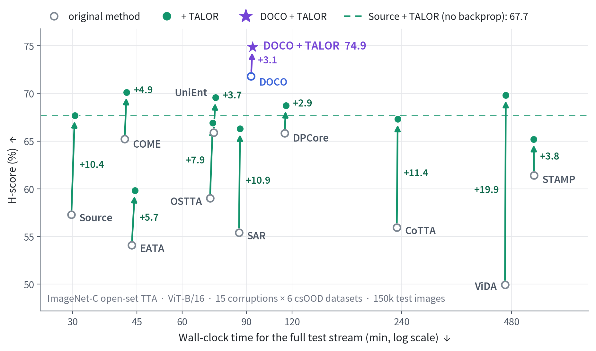
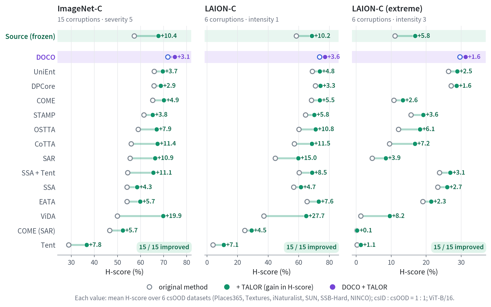
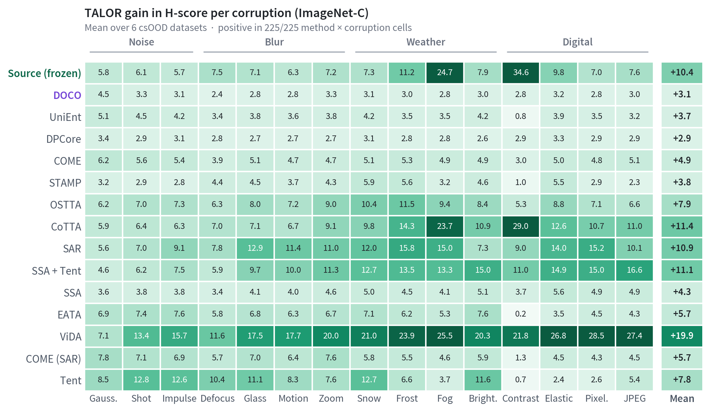
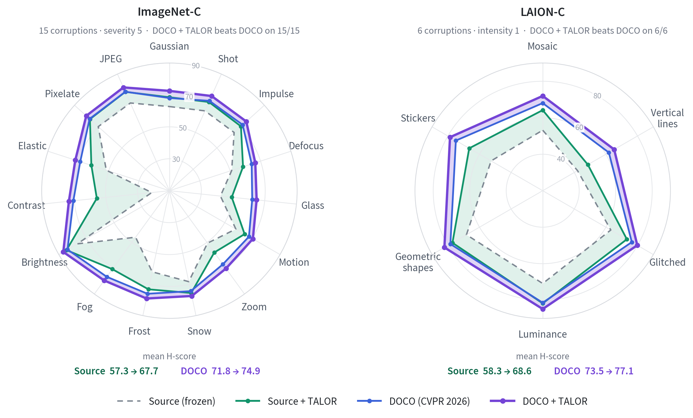
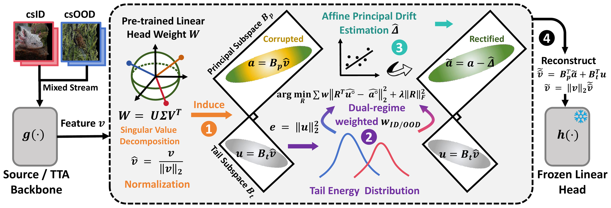
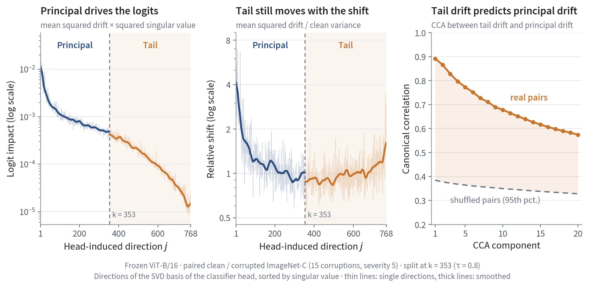

<div align="center">

#  Tail Cues, Principal Corrections: Plug-and-Play<br>Rectification for Open-Set Test-Time Adaptation

**Yingkai Yang** &nbsp;·&nbsp; **Chaoqi Chen** &nbsp;·&nbsp; **Hui Huang**

**NeurIPS 2026**

[](https://arxiv.org/abs/2610.36870) [](https://neurips.cc/) [](https://huggingface.co/datasets/ekyleyang/DOCO-LAION-C) [](https://github.com/ekyle0522/DOCO) [](LICENSE)

</div>

<p align="center">
  
</p>
<p align="center"><em>H-score vs. wall-clock time on ImageNet-C. Each arrow attaches TALOR to one method: the arrows go up, not right.</em></p>

**TALOR** (**T**est-time **A**daptation via **L**inear **O**nline **R**ectification) is a small, backward-free module that sits between the feature extractor and the frozen linear head. It uses the head's own SVD to split every feature into high-gain *principal* coordinates and low-gain *tail* coordinates, predicts from the tail how the distribution shift has moved the principal coordinates, and subtracts that drift before the unchanged head. It needs no backpropagation, no source data and no source statistics. It works on a frozen model and on top of other TTA methods.

## ✨ Highlights

Metric: **H-score**, the harmonic mean of ID accuracy and OOD AUROC. Backbone: ViT-B/16. Stream: csID : csOOD = 1 : 1.

- **Strong on its own.** On a frozen ViT-B/16, TALOR raises the ImageNet-C H-score from 57.3 to **67.7 (+10.4)** without a single gradient step. That is higher than 13 of the 14 TTA methods we compare with. Against UniEnt (65.9), the strongest of them apart from DOCO, it runs 2.4× faster and uses 12 % of the GPU memory.
- **Plug-and-play.** Attached to a frozen model or to each of the 14 TTA / open-set TTA methods, TALOR improves all of them on ImageNet-C, LAION-C and extreme LAION-C (270 / 270 method × csOOD × benchmark settings). On ImageNet-C the gains range from +2.9 (DPCore) to +19.9 (ViDA).
- **DOCO × TALOR.** Our CVPR 2026 method [DOCO](https://github.com/ekyle0522/DOCO) combined with TALOR gives the highest H-score in the benchmark: **74.9** on ImageNet-C (+3.1 over DOCO) and **77.1** on LAION-C (+3.6).
- **Almost free.** At most 2.2 % extra wall-clock time on ImageNet-C and about 154 MiB extra GPU memory (1,566 → 1,720 MiB on the frozen model).

## 📊 Results

### Plug-and-play on 15 methods and 3 benchmarks

<p align="center">
  
</p>

TALOR raises the mean H-score of all 15 methods on all three benchmarks. At the level of single domains (method × csOOD dataset × corruption, 2,430 in total), it raises the H-score in 2,363 (97.2 %), ties in 57 and lowers it in 10, by at most 0.16 points.

### Gains per corruption

<p align="center">
  
</p>

Averaged over the six csOOD datasets, the gain is positive for every method and every ImageNet-C corruption. For the frozen model it is largest on contrast (+34.6) and fog (+24.7).

### DOCO × TALOR

[DOCO](https://github.com/ekyle0522/DOCO) (CVPR 2026) disentangles domain shift from semantic novelty through back-to-source domain compensation. TALOR then removes the drift that remains in the head's principal subspace. The two are complementary: DOCO + TALOR beats DOCO on 15/15 ImageNet-C corruptions and 6/6 LAION-C corruptions.

<p align="center">
  
</p>

## 🧭 How TALOR works

<p align="center">
  
</p>

1. **Head-induced coordinates.** The SVD of the frozen head, *W = UΣVᵀ*, splits the normalized feature into principal coordinates (the top singular directions holding τ = 80 % of the spectral energy) and tail coordinates. On ViT-B/16 this gives 353 principal and 415 tail dimensions.
2. **Tail cues.** Tail coordinates barely change the logits, but they respond to the shift, and their drift linearly predicts part of the principal drift (*tail-to-principal leakage*, see below).
3. **Soft-routed affine drift.** A two-component GMM on the tail energy ‖u‖² gives soft ID / OOD responsibilities. For each branch TALOR keeps a principal mean and a tail-to-principal slope, fitted online by weighted ridge regression and smoothed with an EMA. The ridge problem is solved in its dual form, so its cost depends on the batch size rather than on the tail dimension.
4. **Rectified inference.** The predicted drift is subtracted from the principal coordinates only. The feature is rebuilt with the untouched tail and the original norm, then passed to the unchanged head.

The same hyper-parameters are used everywhere: τ = 0.8, EMA momentum β = 0.9, ridge λ = 0.01.

### Why tail cues?

<p align="center">
  
</p>

We compare the features of clean ImageNet images and their corrupted copies on a frozen ViT-B/16, in the basis induced by the classifier head. Drift in the principal coordinates accounts for most of the change in the logits (left). The tail coordinates barely reach the logits, yet their drift is about as large as their clean variation (middle), and it linearly predicts the principal drift far better than shuffled pairs do (right). TALOR therefore reads the shift from the tail and corrects only the principal coordinates. ResNet-50 shows the same pattern (see the paper's appendix).

## 📌 Citation

If TALOR helps your research, please cite:

<!-- Switch to the NeurIPS 2026 proceedings entry once it is online. -->
```bibtex
@article{yang2026talor,
  title   = {Tail Cues, Principal Corrections: Plug-and-Play Rectification for Open-Set Test-Time Adaptation},
  author  = {Yang, Yingkai and Chen, Chaoqi and Huang, Hui},
  journal = {arXiv preprint arXiv:2610.36870},
  year    = {2026}
}
```

If you use DOCO + TALOR, please also cite DOCO:

```bibtex
@inproceedings{yang2026backtosource,
  title     = {Back to Source: Open-Set Continual Test-Time Adaptation via Domain Compensation},
  author    = {Yang, Yingkai and Chen, Chaoqi and Huang, Hui},
  booktitle = {Proceedings of the IEEE/CVF Conference on Computer Vision and Pattern Recognition},
  year      = {2026}
}
```

## 🎈 Acknowledgments

Our framework builds on [DPCore](https://github.com/yunbeizhang/DPCore) and [DOCO](https://github.com/ekyle0522/DOCO). We also thank the authors of [STAMP](https://github.com/yuyongcan/STAMP), [COME](https://github.com/BlueWhaleLab/COME), [UniEnt](https://github.com/gaozhengqing/UniEnt), [LAION-C](https://github.com/FanfeiLi/LAION-C), [SSA](https://github.com/kzkadc/regression-tta) and [RobustBench](https://github.com/RobustBench/robustbench) for releasing their code.
